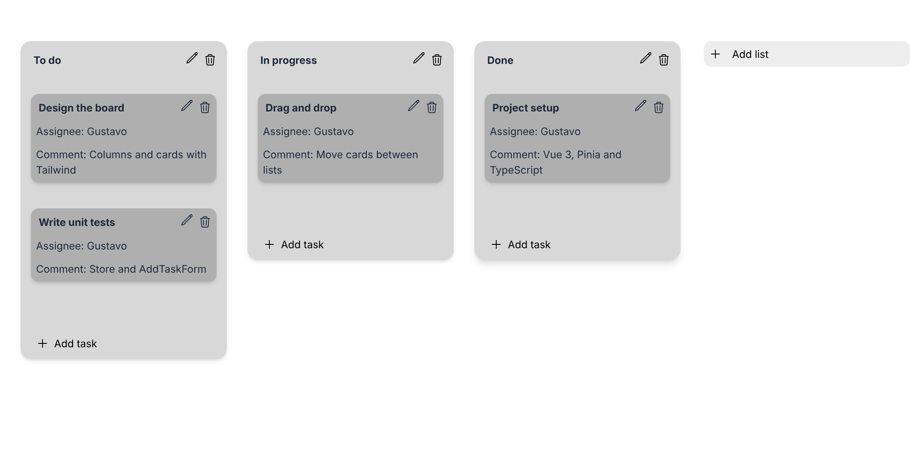

# TrelloLike

[](https://github.com/GustavoAU/trellolike/actions/workflows/ci.yml)

A small Kanban board in the spirit of Trello, built with Vue 3, TypeScript and Pinia.



## What it does

- Create, rename and delete lists. Deleting a list asks for confirmation and removes its tasks too.
- Add tasks with a title, an assignee and a comment. Empty fields are rejected with an inline message.
- Edit a task in a modal (Escape closes it) and delete it with a confirmation step.
- Drag tasks to reorder them or move them to another list.

The board lives in memory, so it resets when you reload the page.

## Stack

| | |
|---|---|
| UI | Vue 3 (`<script setup>`), Tailwind CSS 4, Heroicons |
| State | Pinia store with typed columns and tasks |
| Drag and drop | vuedraggable |
| Tooling | Vite, TypeScript, ESLint, Prettier |
| Tests | Vitest and Vue Test Utils for unit tests, Playwright for end-to-end |

## How it is organised

```
src/
  stores/useTaskBoardStore.ts   board state: columns, tasks per column, add/edit/remove
  components/
    ColumnList, SingleColumn     lists on the board
    TaskList, SingleTask         tasks inside a list, drag and drop
    AddTaskForm, ColumnForm      creation forms with validation
    ElementHeader, ModalLayout   title bar with edit and delete, edit modal
    DynamicInput, CustomButton   shared form controls
e2e/board.spec.ts                user flows in a real browser
```

## Run it locally

Requires Node 22 and pnpm.

```sh
pnpm install
pnpm dev
```

## Tests and checks

```sh
pnpm test:unit        # unit tests in watch mode
pnpm test:e2e         # end-to-end tests (first time: pnpm exec playwright install chromium)
pnpm type-check
pnpm lint:check
pnpm format:check
```

Every pull request runs all of these on GitHub Actions: lint, format, type check, unit tests and a production build first, then the Playwright suite against the built app.

## What I would add next

- Save the board in `localStorage` so it survives a reload.
- Keyboard support for moving tasks between lists.
